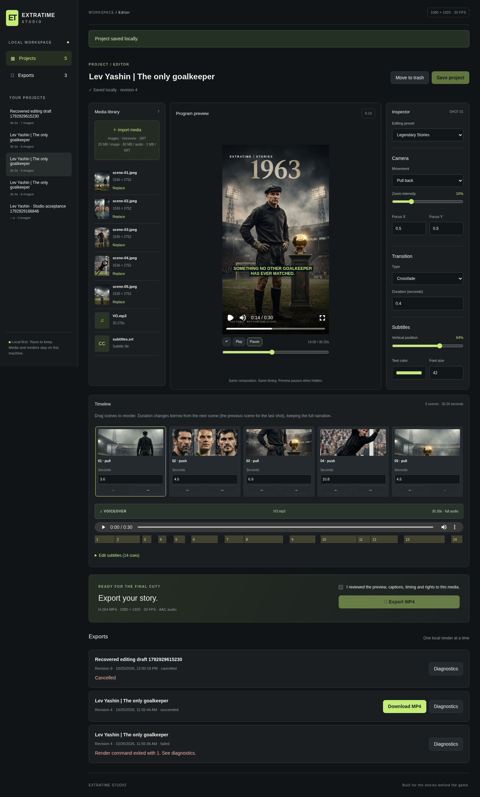

# Phase 1 — PASS: EXTRATIME STUDIO

The browser workflow is implemented and verified against the existing Phase 0 baseline `bd98dfa`. A real project was created in the dashboard, the five original Lev Yashin images, MP3 and 14-cue SRT were uploaded, its timeline was edited and saved, the preview was played/seeked, and Export invoked the existing renderer. The completed MP4 was downloaded through the browser and independently validated. Phase 2 and Phase 3 have not started.

## Delivered

- Responsive Next.js/TypeScript/Tailwind dashboard with projects, editor, media library, inspector, timeline, subtitle editor and exports.
- Local atomic JSON persistence, optimistic revisions, explicit save, unsaved-edit navigation protection, browser draft recovery, and reversible project deletion/restore.
- Actual JPG/PNG/WebP and MP3/WAV uploads, content decoding and size limits, thumbnails, audio duration metadata, image replacement, SRT import and editable caption timing/text.
- The Remotion Player directly uses `src/engine/Video.tsx` with the same manifest sent to the worker. It supports play/pause/restart/seek, time display and visibility pause. There is no separate preview animation logic.
- Scene drag/drop and keyboard-accessible reorder buttons. Duration edits redistribute frame counts to a neighbour while retaining full narration coverage.
- Functional Documentary/Fast Viral/Legendary Stories presets; movement, intensity, focus, pan direction, transition type/duration and subtitle appearance controls.
- Detached render worker invoking the existing `scripts/render.ts`, immutable manifest snapshots, filesystem concurrency lock, real progress, cancellation, diagnostics, verification and MP4 download. Only successful, verified jobs are downloadable.
- Project-owned UUID asset references, path containment, bounded request bodies, origin checks and cross-project ownership validation.

New `panDirection`, `transitionDuration` and `captionFontSize` fields are optional. Old manifests keep their Phase 0 defaults. `scripts/render.ts` itself is unchanged. The subtitle acceptance script accepts an optional manifest argument for checking dashboard exports without overwriting Phase 0 evidence.

## Actual verification

| Check | Result |
| --- | --- |
| Unit/storage suite | **18 passed**, including all 11 Phase 0 tests; no Episode 001 binary fixtures needed for the unit suite |
| Lint / typecheck | **PASS** (`npm run lint`, `npm run typecheck`) |
| Production build | **PASS** (`npm run build`) |
| Full production browser suite | **2 passed**, ~1.8 minutes, against `next start` on port 3001 |
| Create → upload → preview → edit → save → render → download | **PASS**, real Episode 001 files and actual MP4 |
| Refresh and data protection | **PASS**: saved timeline reopens; unsaved draft recovers; stale tab save rejected with HTTP 409 |
| Upload failures | **PASS**: corrupt image rejected and rolled back; oversize body/file limits checked; original assets preserved |
| Supported replacements | **PASS**: PNG, WebP and WAV through browser; equal-duration voiceover replacement preserves edited timing |
| Timeline / captions | **PASS**: native drag/drop, arrow reorder, duration redistribution, manual captions and persistence |
| Preview/export match | **PASS**: same frame 420 (14s), mean absolute RGB error **3.6668 / 255** after MP4 downscaling; comparison excludes Player transport controls |
| Failure recovery | **PASS**: one isolated project image intentionally removed; real render fails with diagnostics; file restored; subsequent export succeeds |
| Concurrency / cancel | **PASS**: duplicate export rejected; explicit cancel reaches cancelled state and releases the worker |
| API isolation | **PASS**: foreign origin rejected, path traversal rejected, foreign/unmanaged audio references rejected |
| MP4 format | **1080×1920, 30 FPS, H.264/yuv420p, AAC 48 kHz** |
| Duration / audio | Source **30.275875s** retained; 909-frame video **30.3s**; container **30.315s**; decoded audio correlation **0.9999772973** |
| Ending narration | Last-half-second RMS source **0.0047061859**, output **0.0046939423**; no truncation |
| Real SRT captions | **14 visible mobile-safe cues**, eight caption-free gaps, nine phrase onsets within one frame, final “WHO'S NEXT?” visible on frame 908 |
| Black-frame scan | Entire 909-frame downloaded MP4 scanned; **zero black intervals** |
| Original media | All six Phase 0 source files retain their recorded SHA-256 checksums |
| Legacy visual compatibility | Frames 15, 111 (transition), 420 and 908 compared against the accepted Phase 0 MP4: mean RGB errors **3.06, 2.45, 3.14, 2.56 / 255** |
| Browser exceptions | **0** in the full export workflow |

The production tests additionally verify there is no horizontal page overflow at 390px width. Both development and production servers were exercised. Rendering/validation was performed on Linux; M4 hardware, Safari and Firefox were not benchmarked/tested. Pixel error includes browser scaling, font rasterization and H.264 compression; this is a tolerance comparison, not a claim of byte-identical PNG/MP4 pixels. Timing checks use the provided exact SRT and source waveform; no new speech transcription was performed.

## Files produced

- **MP4:** `outputs/phase-1/episode-001-dashboard.mp4` (downloaded through the UI).
- Matching manifest/SRT: `outputs/phase-1/episode-001-dashboard.json`, `outputs/phase-1/episode-001-dashboard.srt`.
- Media report: [episode-001-dashboard.validation.json](phase-1/episode-001-dashboard.validation.json).
- Subtitle report: [episode-001-subtitle-validation.json](phase-1/episode-001-subtitle-validation.json).
- Browser evidence: [browser-evidence.json](phase-1/browser-evidence.json), [interaction-evidence.json](phase-1/interaction-evidence.json).
- Legacy frame evidence: [legacy-compatibility.json](phase-1/legacy-compatibility.json).
- Artifact checksum and acceptance summary: [acceptance.json](phase-1/acceptance.json).
- Screenshots: [desktop editor](phase-1/editor-desktop.png), [mobile editor](phase-1/editor-mobile.png), [completed export](phase-1/export-complete.png).
- Pixel comparison: [preview frame](phase-1/preview-frame-420.png), [export frame](phase-1/export-frame-420.png).



## Reproduce

```sh
npm ci
npm run lint
npm run typecheck
npm test
npm run build
CHROME_PATH=/usr/bin/chromium npm start -- --port 3001
# In a second terminal, with original Episode 001 media present:
STUDIO_URL=http://127.0.0.1:3001 CHROME_PATH=/usr/bin/chromium npm run test:e2e
npm run validate -- outputs/phase-1/episode-001-dashboard.json outputs/phase-1/episode-001-dashboard.mp4
npm run validate:subtitles -- outputs/phase-1/episode-001-dashboard.mp4 outputs/phase-1/episode-001-dashboard.json
CHROME_PATH=/usr/bin/chromium npx tsx scripts/verify-legacy.ts
```

`verify-legacy.ts` also needs the retained Phase 0 MP4. Browser tests deliberately exercise failure/recovery on a private copied asset and restore it in `finally`. Test projects and render history remain on the local machine for inspection. Generated media/metadata and MP4s remain gitignored; code, SRT fixtures, reports and screenshots are committed.

## Deployment boundary and remaining scope

Run the app locally after cloning; Codex Cloud is not permanent hosting. The development server is not expected to survive this task. See README for Chrome/FFmpeg installation, local server commands, optional storage root and backup paths. This MVP is a local single-user tool, not an authenticated internet deployment. Deleted/replaced media are retained to prevent data loss; permanent cleanup is manual. The dashboard serializes its workers, but manually launched CLI renders must be scheduled separately. Runtime snapshots still require their local media files to remain available.

Automatic transcription, automatic image segmentation, batch production, cloud rendering and publishing are deferred. No model downloads, paid AI API calls or database services were added.
