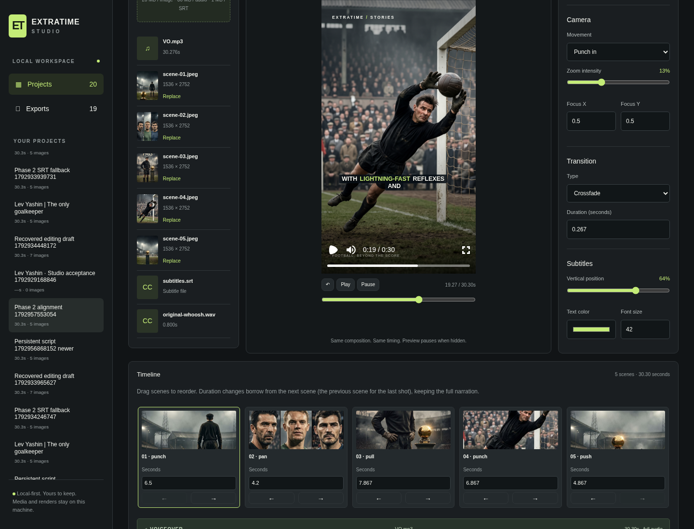
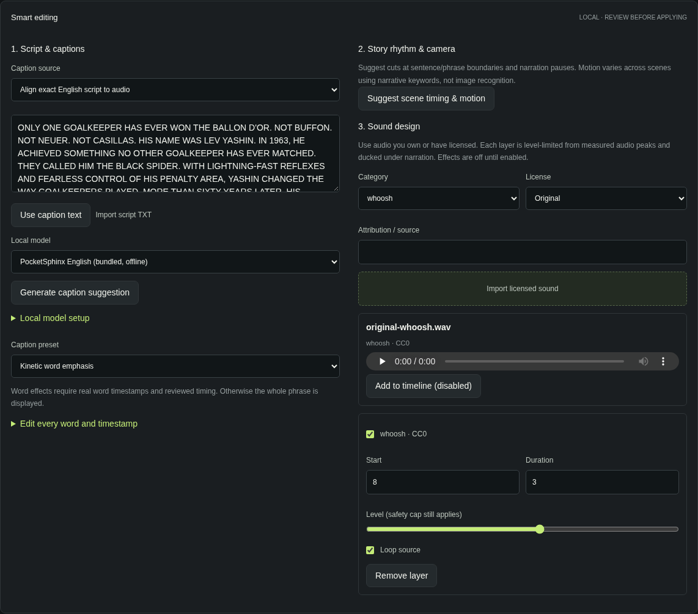

# Phase 2 — PASS: Episode 001 script-alignment workflow

Verified on 2026-10-26 (Asia/Jakarta). The original Episode 001 images and English voiceover were imported through the existing dashboard, an exact script was aligned locally, captions and word timestamps were edited/reviewed, scene suggestions accepted, an original licensed sound layer mixed, and a real MP4 exported and downloaded. **All five browser cases passed with `REQUIRE_ALIGNMENT=1`; none were skipped.** Offline Whisper inference remains unverified without separately imported weights; this is a documented limitation, not a claimed transcription result. Phase 3 has not started.

## Baseline and compatibility

The branch `feat/phase-2-smart-editing` starts from `de2d3cc`, containing Phase 1 implementation `528be7e` and Phase 0 baseline `bd98dfa`. Phase 1 PR #1 remains the base of the separate Phase 2 PR.

Before implementation, the existing **18 tests, lint, typecheck and production build passed**. The dashboard and renderer were inspected and reused. `scripts/render.ts` is unchanged. Preview and export still use the same `Film` composition and manifest; `Captions` and `soundVolume` are shared rendering components/functions. New manifest fields are optional, preserving legacy defaults. The original images, MP3 and 14-cue SRT remain intact.

## Delivered behavior

- **Local alignment:** explicit PocketSphinx setup, exact-script constrained acoustic decoding and state alignment, English number normalization, curated football-name pronunciations and pronunciation-variant handling. Output retains real word timestamps, script/audio checksums, model identity, warnings and review requirements. Unknown pronunciations fail with an actionable error instead of invented timings.
- **Offline model support:** local folder import, required-file checks, checksums and duplicate-name rejection. The imported PocketSphinx model was used for real inference and produced the same word times as the bundled model. Whisper accepts an imported CTranslate2 directory with `local_files_only=True`, CPU int8 and two threads. Missing weights leave manual SRT available; rendering never initiates speech-model downloads.
- **Captions:** script text persists in project metadata/drafts. Generation creates a revision-bound suggestion, applied only on explicit acceptance. Every phrase/word timestamp and text remains editable. Documentary, minimal, underline and kinetic presets share the same composition. Unreviewed/flagged word timing falls back to whole phrases; word edits clear review, phrase edits clear stale word metadata. Extra spacing reserves room for kinetic emphasis.
- **Smart timing and motion:** reviewable before/after recommendations use sentence boundaries, pauses and narration keywords, maintain exactly 909 frames for this episode and vary push/pan/pull/punch movements. They do not reorder images or change approved timing without acceptance. They are deterministic heuristics, not image recognition. Manual controls remain available.
- **Sound:** locally uploaded licensed MP3/WAV layers support whoosh, impact, riser, stadium and music categories, individual enable/disable, timing, looping, fades and volume. Measured source peak and VO RMS cap the mix; narration regions duck sounds by 80%, active layers share the budget, and narration plays at 90% gain for headroom without changing speed/duration. CC BY requires attribution. Tests use an original CC0 synthetic whoosh, not a third-party recording.
- **QC and recovery:** shared caption DOM geometry checks safe bounds, line count and text collisions before export; post-render checks validate streams, full narration coverage, all-frame black intervals and clipping. Existing source/output audio correlation and tail checks still run. JSON reports are available beside exports. One compute lock coordinates speech and dashboard rendering; stale suggestions and duplicate work are rejected. Actual storage-failure injection verifies that a failed job setup releases the lock. Parent assigns ownership to the spawned worker immediately. Requests applying changes temporarily disable editing/navigation to prevent late-response data loss.

## Actual verification

| Check                               | Result                                                                                                                                                              |
| ----------------------------------- | ------------------------------------------------------------------------------------------------------------------------------------------------------------------- |
| `npm test`                          | **24 TypeScript + 4 Python tests passed**, retaining all 18 baseline tests                                                                                          |
| Lint / typecheck / production build | **PASS**                                                                                                                                                            |
| Complete production browser suite   | **5 passed, 5.2 minutes**, `REQUIRE_ALIGNMENT=1`; real exports and downloads, no skipped model case                                                                 |
| Final worker recovery check         | Production browser cancellation/replacement/draft test rerun after lock cleanup hardening; result in `phase-2/worker-browser-test.log`                              |
| Model setup                         | Explicit PocketSphinx 5.1.1 installation; 34.2 MB source package / 29.2 MB built wheel. Cloud compiler override `CC=gcc CXX=g++` resolved inherited missing `clang` |
| Real alignment                      | **64 display words, 21 caption cues**, no structural timing warnings; original text fully covered                                                                   |
| Determinism                         | Two independent CLI runs produced byte-identical alignment JSON; checksum in `phase-2/reproducibility.json`                                                         |
| Independent SRT phrase anchors      | Median onset difference **70 ms**, maximum **410 ms** across 14 original cues; old SRT timestamps were not alignment inputs                                         |
| Local model import                  | File copy/checksums/catalog/duplicate rejection and real imported-model inference passed; timestamps match bundled model                                            |
| Script and suggestion persistence   | Browser refresh retains script; another tab's newer revision prevents stale suggestion acceptance                                                                   |
| MP4                                 | **1080×1920, 30 FPS, H.264/yuv420p, AAC**, 909 frames                                                                                                               |
| Full narration                      | Original **30.275875s** retained; video **30.300s**, container **30.315s**                                                                                          |
| Audio preservation                  | Correlation **0.9999711278**; final-half-second RMS source **0.00470619**, mixed output **0.00422548** (90% VO gain retained at the end)                            |
| Preview/export consistency          | Same frame 203, mean absolute RGB error **2.8987 / 255** after scaling, excluding Player transport controls                                                         |
| Encoded kinetic captions            | Actual MP4 pixels checked at **all 64 word midpoints**; minimum **196 highlight-color pixels**, all passed                                                          |
| Caption geometry                    | **64 active-word samples**, within x=75–945 and y=480–1600, at most two lines, no measured text collisions                                                          |
| Black frames / clipping             | Full 909-frame scan: **zero black intervals**, peak **−6.960337 dBFS**                                                                                              |
| Real sound layer                    | Residual/source-whoosh correlation **0.4827** versus control windows ≤ **0.0111**; confirms the actual effect is present under narration                            |
| Legacy frames                       | Frames 15/111/420/908 versus Phase 0 MP4: RGB errors **3.0647 / 2.4506 / 3.1450 / 2.5569**, all below 5                                                             |
| Negative QC                         | Moving baseline captions to 85% height correctly fails all 14 unsafe samples                                                                                        |

The five browser cases cover both Phase 1 regressions (real uploads, replacements, two-tab conflicts, draft recovery, drag/reorder, failure/retry, duplicate exports and cancellation), the manual-SRT fallback export, the real aligned-caption export, and script persistence/stale-assistance handling. An initial pair of concurrent Playwright invocations collided on shared trace files and the render lock; those failed runs were corrected by using one sequential invocation and are not counted as passes.

## Produced files and screenshots

The complete, browser-downloaded aligned MP4 is local and gitignored:

- `outputs/phase-2/aligned/episode-001.mp4`
- `outputs/phase-2/aligned/manifest.json`
- `outputs/phase-2/aligned/alignment.json`
- `outputs/phase-2/aligned/validation.json`
- `outputs/phase-2/aligned/episode-001.kinetic.json`
- `outputs/phase-2/srt-fallback/episode-001.mp4` (manual SRT fallback with motion/sound)

Committed evidence is in [phase-2/](phase-2/): alignment and timing review, MP4 validation/QC, browser results, model-import results, checksums and test/build logs. Source media and model weights are deliberately not committed.





Representative **actual MP4** frames were extracted and inspected, including word emphasis and the final caption:

- [Frame 297: Yashin](phase-2/frame-297.png)
- [Frame 578: active word on two-line caption](phase-2/frame-578.png)
- [Frame 908: final caption and narration tail](phase-2/frame-908.png)

## Reproduce locally

Follow README for dependency setup, local model installation/import and original media placement. Start the production server with a configured local Chromium, then:

```sh
npm test
npm run lint
npm run typecheck
npm run build
CHROME_PATH=/usr/bin/chromium npm start -- --port 3001
# Separate terminal; never run two Playwright invocations against this storage concurrently:
REQUIRE_ALIGNMENT=1 STUDIO_URL=http://127.0.0.1:3001 CHROME_PATH=/usr/bin/chromium npm run test:e2e
npx tsx scripts/validate-alignment.ts outputs/phase-2/aligned/alignment.json
npx tsx scripts/validate-kinetic.ts outputs/phase-2/aligned/manifest.json outputs/phase-2/aligned/episode-001.mp4
python3 scripts/verify-sound-fixture.py outputs/phase-2/aligned
```

`episodes/episode-001/narration.txt` is the concatenated **text only** of the supplied exact SRT, not a separately supplied narration document. Alignment receives the script and original audio; the SRT is used separately for independent phrase-anchor comparison. The browser test exercises the timing review control; this does not substitute for a human listening review or establish perceptual accuracy of every word. These are acoustic alignment estimates, not word-level ground truth. Generated phrasing, scene/image relevance and emphasis remain editable.

No Whisper weights were downloaded, and real Whisper recognition has **not** been verified. No fanless M4 hardware benchmark, automatic image understanding, license verification service or full editorial-quality classifier is claimed. Codex Cloud is only the development/test environment; run the app locally after cloning. Phase 3 is out of scope.
